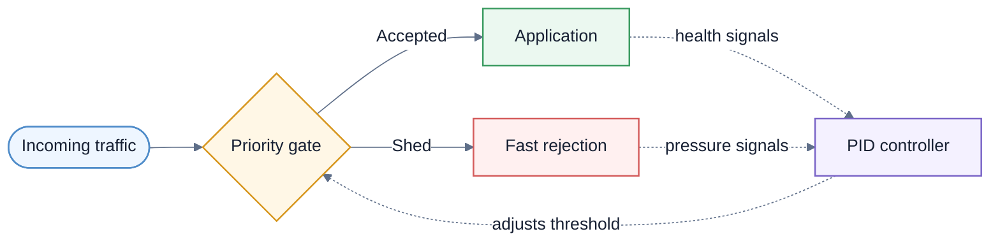
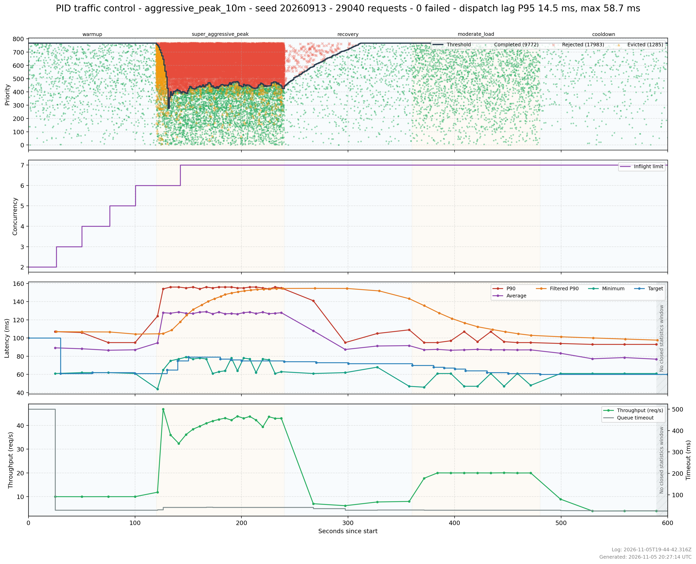

# Adaptive Admission Controller for Node.js

[](https://github.com/jfrz38/rate-limit-pid-controller/actions/workflows/codeql.yml)
[](https://github.com/jfrz38/rate-limit-pid-controller/blob/main/LICENSE)

Node.js host and framework adapters for the Rust/WebAssembly
[`adaptive-admission-controller`](https://github.com/jfrz38/adaptive-admission-controller).
The controller combines priority-aware load shedding, bounded queueing, adaptive concurrency,
statistics, and PID feedback. Node.js 24 or newer and ESM are required.

## Usage

Choose the integration boundary that matches the application:

- **Node host** — execute arbitrary JavaScript work through the Promise-based Rust/Wasm host SDK.
  🔗 [Node Host README](./code/hosts/node/README.md) [](https://www.npmjs.com/package/@jfrz38/adaptive-admission-node)

- **Framework Adapters**  
  Plug the controller into your framework with minimal setup:  
  🔗 [Express Adapter](./code/adapters/express/README.md) [](https://www.npmjs.com/package/@jfrz38/pid-controller-express)  
  🔗 [NestJS Adapter](./code/adapters/nestjs/README.md) [](https://www.npmjs.com/package/@jfrz38/pid-controller-nestjs)

Explore the [simulation examples](./simulation/README.md) to see the controller under different
traffic loads and latency scenarios.

## Motivation

Uber’s Cinnamon introduced a novel approach to rate limiting by combining **PID controllers** with traffic-shaping techniques.  
Unlike classic token bucket or leaky bucket implementations, this design allows for:

- Adjust limits **dynamically** based on system feedback.
- Handle bursts and varying loads **smoothly**.
- Maintain **predictable latencies** while avoiding over-provisioning.

This project implements a **simplified, opinionated version** of Cinnamon’s approach for easy integration and experimentation.

<sub><sup>_(simplified logic):_</sub></sup>



## Features

- PID-based dynamic rate limiting.
- Pluggable adapters for different frameworks (e.g., NestJS, Express).
- Configurable thresholds, recovery, and overload handling.
- Designed for **high concurrency** environments.
- Priority-based shedding dropping background tasks during high-load periods while keeping critical requests alive.
- Promise-based host API that propagates accepted results, rejections, evictions, and task failures.

## How it works

Standard rate limiters are static: you set 100 RPS, and it stays at 100 RPS. This project uses a **PID Controller**, which acts like a **smart thermostat** for your server:

1. **Error Calculation**: It constantly compares your current system health (latency/concurrency) against a "ideal" target.
2. **Dynamic Thresholding**: Instead of a fixed number, it calculates a **Priority Threshold**.
3. **Load Shedding**: Only requests with an effective priority value below the current threshold are allowed.
4. **Self-Correction**: If the server slows down, the PID raises the threshold automatically. As it recovers, it gracefully lowers it back.

The Node host exposes priorities through a `Priority` class. Use `Priority.fromTier(0..5)` for
tier-based traffic or `Priority.fromValue(0..767)` for a complete tier/cohort value.

## Simulation in action

The latest simulation report shows how the controller responds to the executed traffic pattern. See the [simulation suite](./simulation/README.md) for the available scenarios and how to reproduce the report.



## Packages and releases

This repository contains several npm packages that are versioned and released independently:

- `@jfrz38/pid-controller-express` uses tags like `express-vX.Y.Z`.
- `@jfrz38/pid-controller-nestjs` uses tags like `nestjs-vX.Y.Z`.
- `@jfrz38/adaptive-admission-node` uses tags like `node-vX.Y.Z` and embeds the validated
  WebAssembly component, so npm consumers do not need Rust or Cargo.

GitHub Releases are therefore package-specific. `npm` is the source of truth for each package's `latest` version, because npm tracks the `latest` dist-tag per package while GitHub only has one repository-level latest release.

## Development

Common project tasks are exposed through the root `Makefile`:

```bash
make install-code
make verify-node-component
make build
make test
make ci
```

Package-specific checks are also available:

```bash
make validate-node
make validate-express
make validate-nestjs
```

Run `make help` to list all available targets.

### Local package testing

Build a package and create a local tarball with `PACKAGE=node`, `shared`, `express`, or `nestjs`:

```bash
make pack-local PACKAGE=node
```

The command prints a `pnpm remove <package> && pnpm add --force <tarball>` command for another local project. It removes the installed package before adding the local artifact, so the artifact replaces it even when its version number has not changed.

## Migrating from the TypeScript core

`@jfrz38/pid-controller-core` is retired. Direct consumers should migrate to
`@jfrz38/adaptive-admission-node`; Express and NestJS users should upgrade their existing adapter to
`0.2.x`. The adapter READMEs document configuration and error changes. The old npm package will be
deprecated only after the replacement packages have been published from a validated `main`
release.

## References

- [Cinnamon: Using Century Old Tech to Build a Mean Load Shedder](https://www.uber.com/en-ES/blog/cinnamon-using-century-old-tech-to-build-a-mean-load-shedder/?uclick_id=023fa4c1-0abf-4379-ad4d-62ed0a214924).  
- [PID Controller for Cinnamon](https://www.uber.com/en-ES/blog/pid-controller-for-cinnamon/?uclick_id=023fa4c1-0abf-4379-ad4d-62ed0a214924).  
- [Cinnamon Auto-Tuner: Adaptive Concurrency in the Wild](https://www.uber.com/en-ES/blog/cinnamon-auto-tuner-adaptive-concurrency-in-the-wild/).  
